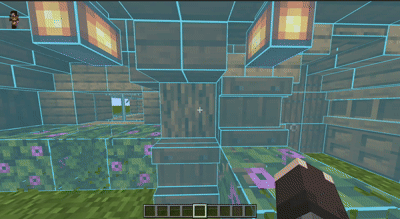
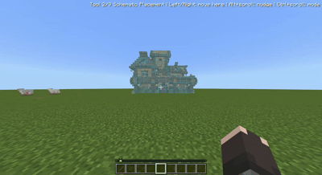
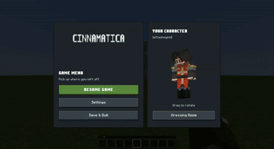
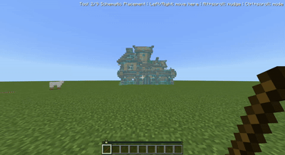
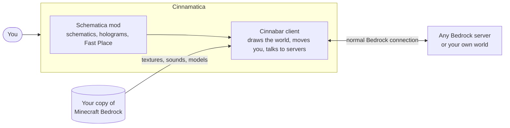

# Cinnamatica

**Schematic building for Minecraft: Bedrock Edition**, built on the [Cinnabar](https://github.com/cinnabar-mc/cinnabar) client.

Import a Java schematic or a Bedrock structure, see it as a hologram in your world, and build it by hand or with Fast Place.

> [!IMPORTANT]
> **Not an official Minecraft product.** Not approved by or associated with Mojang or Microsoft. Minecraft is a trademark of Microsoft Corporation; its code and assets belong to Mojang and Microsoft under the [Minecraft EULA](https://www.minecraft.net/eula). Cinnamatica ships no Minecraft files. You need your own copy of the game.

## Features

- **Schematic import:** `.schematic`, `.schem`, `.litematic` and Bedrock `.mcstructure` files go into a library you can load at any time.
- **Target info:** shows the planned block, the real block and what Fast Place will do. Debug mode explains why a placement won't work.
- **Container highlights:** chests and shulkers holding blocks you still need are outlined.
- **Paste build:** places a whole schematic at once (Creative, operator only).

Press **M** in-game to open the schematic menu. The [Cinnamatica guide](builder/README.md) covers every control and setting.

### Easy Place: Fast Place and Hold to Place

Look at a ghost block and click. Cinnamatica picks the right block, turns it the right way and places it. Hold the button to keep placing as you look around.

  

### Holograms

Your schematic shows up as see-through ghost blocks. Missing blocks stay ghosts, wrong blocks are marked, and you can show one layer at a time so big builds stay readable.

<table>
  <tr>
    <td align="center"></td>
    <td align="center"></td>
  </tr>
  <tr>
    <td align="center"><b>Bottom up:</b> everything up to the chosen layer</td>
    <td align="center"><b>Layer by layer:</b> one layer at a time</td>
  </tr>
</table>

### Move your schematic

Use the placement tool to slide the hologram into place before you start building.

  

### Works in Survival

Everything works in Survival just like in Creative. The only difference: in Survival, Fast Place uses the blocks in your inventory and hotbar instead of the Creative menu.

## Install

| Platform | Download | Build from source |
| --- | --- | --- |
| **Windows** | Installer or portable ZIP from [Releases](https://github.com/Ahwfr/cinnamatica/releases) | [Windows guide](builder/windows/README.md) |
| **Linux** | `.AppImage` (any distribution) or `.deb` (Debian, Ubuntu) from [Releases](https://github.com/Ahwfr/cinnamatica/releases) | [Linux guide](builder/linux/README.md) |
| **iOS** | Not available yet | [Port status](builder/ios/README.md) |
| **Android** | Not available yet | [Port status](builder/android/README.md) |

On first launch, Cinnamatica prepares the Minecraft assets it needs from your own game files.

## How it works

A quick way to picture it: a Minecraft server is like a website, and the game you play with is like the web browser you visit it in.

**Minecraft Bedrock** is the official game from Mojang: the app you normally play in, plus the servers and worlds you join.

**Cinnabar** is a different app that plays the same game. Think of using Firefox instead of Chrome: the websites are the same, only the browser changes. Cinnabar was written from scratch, but it speaks the same language as Bedrock servers, so servers see a normal Bedrock player. It doesn't come with any Minecraft textures, sounds or models. It reads them from your own copy of the game, which is why you need to own Minecraft.

**Cinnamatica** is Cinnabar with a building tool added, a bit like a browser with an extension installed. Cinnabar still does the actual playing: drawing the world, moving you around and connecting to servers. The **Schematica mod** adds the schematic library, the holograms and Fast Place. The mod runs in a sandbox, so it can only do what Cinnabar allows.

**Is Fast Place a hack?** Fast Place doesn't do anything a player couldn't do by hand. It picks the right block, puts it in your hand and aims for you, then sends the same placement a normal player sends. The server still decides whether the block goes down. Some servers don't allow building helpers, so check the rules before you use it.

For developers: where the code lives

| Part | What it does | Where |
| --- | --- | --- |
| **Cinnabar client** | The Bedrock client itself: rendering, world, input and networking (Rust, with a Go core for Xbox sign-in and transport). | [`app`](app), [`crates`](crates), [`core`](core) |
| **Schematica mod** | The schematic library, holograms, menus and Fast Place planning. It runs as a sandboxed WebAssembly mod through Cinnabar's mod API. | [`builder/schematica`](builder/schematica) |
| **Launcher and packaging** | Builds, starts and packages Cinnamatica for each platform. | [`builder`](builder) |

## Documentation

- [Cinnamatica guide](builder/README.md): controls, settings and Fast Place modes
- [Release notes](builder/RELEASE-NOTES.md) and [update notes](builder/UPDATE.md)
- [Contributing](CONTRIBUTING.md)

## Credits

| Contributor | Work |
| --- | --- |
| **[Ahwfr](https://github.com/Ahwfr)** | Creator and maintainer of Cinnamatica: the Schematica mod, schematic import, holograms, Fast Place and the Windows releases. |
| **[ThsSilentKnight](https://github.com/ThsSilentKnight)** | The Linux port (build and launch scripts, schematic picker, AppImage and `.deb`), the hologram overhaul, the Cinnamatica window, Target info Debug mode and many Fast Place fixes. |
| **[Cinnabar](https://github.com/cinnabar-mc/cinnabar) contributors** | The client Cinnamatica is built on. |

## License

Cinnamatica keeps Cinnabar's [PolyForm Noncommercial license](LICENSE) and [third-party notices](THIRD_PARTY_NOTICES.md). The Schematica mod's own license is in [`builder/schematica/SCHEMATICA-LICENSE.txt`](builder/schematica/SCHEMATICA-LICENSE.txt).

---

  Built on <a href="https://github.com/cinnabar-mc/cinnabar"><b>Cinnabar</b></a>, an open Bedrock client.

